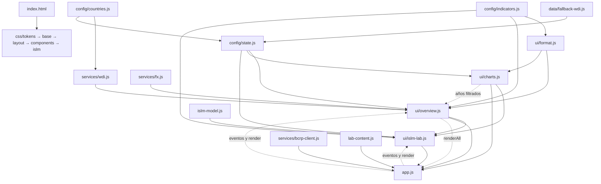

# Arquitectura de MacroScope

## Registro extensible de laboratorios

`MacroScope.labs` es un registro por identificador; actualmente solo contiene `islm`.
Cada entrada expone `id` (clave estable), `title` (título accesible), `createModel(config)`
(factoría del motor independiente del DOM), `controls` (descriptores de controles con
clave, grupo, límites, formato y ayuda), `diagrams` (IDs de los canvas) y `content`
(contenido pedagógico: escenarios, glosario, referencias y calificador). El getter
`content` resuelve `MacroScope.LAB_CONTENT` después de la carga de los scripts diferidos.
Una futura entrada de oferta y demanda, OA–DA, Phillips o Solow debe seguir este
contrato y conservar su propio estado y motor; aquí no se implementan esos modelos.

`labs.islm.snapshot()` expone una instantánea de configuración, parámetros, entradas y
equilibrios E₀/E₁/E₂, además del motor actual para verificaciones numéricas. Los consumidores
no deben mutar sus resultados. La interfaz sigue usando los callbacks públicos existentes,
por lo que no altera las dependencias del comparador ni las de la carga WDI.

El laboratorio integra en `index.html`, `js/ui/islm-lab.js` y `css/islm.css` las ideas
de `prototypes/lab-v2/README.md`: configuración A, experimentación B en acordeones,
barra de capas, rejilla 2×2, comparación A/B y ayuda contextual. No carga archivos del prototipo.
Se usa el canvas existente sin instancias nuevas de Chart; `requestAnimationFrame`
interpola coeficientes de curvas y coordenadas durante 400 ms y entrega exactamente
el destino calculado en el último cuadro. `prefers-reduced-motion` elimina la interpolación.
Cada canvas publica `data-points` y `data-curves` con los datos enviados al renderizador,
`data-animating` y `data-motion`. Los e2e cotejan las coordenadas de los cuatro diagramas
contra `solve(u, 'impact'|'final')`, y verifican los controles, niveles y tamaños responsive.

El flujo guiado usa exclusivamente `LAB_CONTENT.SCENARIOS` y `gradePrediction`.
Cambiar los controles invalida una calificación anterior: es necesario ejecutar de nuevo
el problema para evitar atribuir una predicción al experimento equivocado. Las comparaciones
de regímenes comparten calibración; A/B guarda el equilibrio A de forma inmutable y
expresa B−A con `compareEquilibria`. Los datos observados tienen su propio bloque de
procedencia y los resultados mantienen la etiqueta de simulación teórica.

## Decisión: scripts clásicos, sin compilación

El contrato de apertura local del README y los e2e usan `file://`. Se conservan scripts clásicos con `defer`: los módulos ES exigirían otra política de origen/servidor en los navegadores y cambiarían ese contrato. No hay framework, bundler ni dependencias nuevas.

Cada archivo propio encapsula sus declaraciones en una IIFE con modo estricto y publica los contratos compartidos en **`globalThis.MacroScope`**. Los objetos de configuración y estado se comparten por referencia; no hay copias divergentes del estado. Los callbacks que unen vistas se resuelven al invocarlos (`M.renderAll`, por ejemplo), cuando todos los scripts diferidos ya han terminado. Así se admiten las llamadas de actualización entre vistas sin crear dependencias durante la evaluación de los archivos.

`js/islm-model.js` y `js/lab-content.js` son archivos protegidos que mantienen intactos sus contratos originales `globalThis.ISLM` y `globalThis.LAB_CONTENT` para importarlos en Node. En el navegador, el laboratorio registra el modelo en `MacroScope.ISLM`; `app.js` registra `MacroScope.LAB_CONTENT` y retira los dos nombres globales de compatibilidad. Chart.js conserva su global de biblioteca `Chart`, que también utiliza el renderizador alternativo cuando el CDN falla.

Solo permanece inline la guardia mínima de tema que ya existía, sin declaraciones globales: lee la preferencia antes del primer pintado para conservar la ausencia de parpadeo. Todos los scripts **externos** se cargan con `defer`, sin `async` ni `type="module"`. El SRI y `crossorigin` de Chart.js se mantienen exactamente.

## Dependencias

Las flechas continuas indican datos o llamadas; las punteadas, notificaciones de actualización resueltas después de cargar todos los archivos.



## Orden de carga

CSS conserva el orden de la cascada original: `tokens.css` (colores, familias tipográficas, radio, espaciado y sombras; oscuro por defecto y sobrescrituras claras), `base.css` (reset y documento), `layout.css` (shell y navegación), `components.css` (componentes de las vistas), `islm.css` (laboratorio y reglas adaptables/de impresión al final). Las reglas combinadas y las sobrescrituras se mantienen en su orden relativo para evitar cambios de especificidad o comportamiento responsive.

Después de Chart.js, los scripts clásicos se ejecutan en el orden de las etiquetas:

1. `js/islm-model.js`, `js/lab-content.js`: contratos puros originales.
2. `js/config/countries.js`: catálogo de países y monedas.
3. `js/config/indicators.js`: catálogo WDI, años, metas de inflación y supuestos `ISLM_COUNTRY`.
4. `js/data/fallback-wdi.js`: datos originales y fechas reales disponibles. Las series antiguas sin extracción registrada siguen identificadas como tales; no se les inventa una fecha.
5. `js/config/state.js`: clon del respaldo para uso mutable, procedencia por celda, estado y preferencias.
6. `js/services/wdi.js`, `bcrp-client.js`, `fx.js`: consultas y contratos de datos.
7. `js/ui/format.js`: formato y clasificación.
8. `js/ui/charts.js`: gráficos, fallback y dibujo de diagramas. Registra su listener `DOMContentLoaded` antes que el arranque para que el fallback exista al primer render.
9. `js/ui/overview.js`: panorama, carrusel, tabla/CSV, divisas y coordinación de la actualización WDI/FX.
10. `js/ui/islm-lab.js`: controles, calibración, resultados y narrativa del simulador.
11. `js/app.js`: resuelve los contratos de compatibilidad, registra eventos y arranca al recibir `DOMContentLoaded`.

`api/bcrp.js` continúa como punto de entrada del servidor. No se incorpora a los scripts del navegador. Por `file://`, la consulta BCRP conserva su destino al proxy local y su aviso de indisponibilidad cuando no hay servidor.

## Pureza y efectos

| Archivo/contrato | Puro y utilizable desde Node | Efectos |
| --- | --- | --- |
| `config/countries.js`, `config/indicators.js` | Catálogos; años derivados de la fecha actual | Solo registro en el namespace |
| `data/fallback-wdi.js` | Respaldo local y metadatos | Solo registro de datos; integra el respaldo comercial verificado |
| `islm-model.js`, `lab-content.js` | Modelo, escenarios y predicciones | Conservan sus exportaciones clásicas originales en Node |
| `services/wdi.js`: `normalizeWdiValue`, `validWdiRow`, `parseWdiPage`, `normalizeWdiPages`, `latestAvailable` | Sin DOM, red ni almacenamiento; reciben datos y devuelven valores o errores | Ninguno fuera del registro del contrato |
| `services/wdi.js`: `fetchWdiPage`, `loadWdiSeries` | Importables en Node; pruebas con `fetch`/storage controlados | Red, timeout, reintentos, reloj, caché local |
| `ui/format.js` | Formato numérico y clasificación, sin DOM; importar configuración primero | La clasificación usa el país del estado si no se pasa uno explícito |
| `config/state.js` | Objetos de estado y procedencia | Lee localStorage con protección; mutación compartida |
| `services/fx.js` | Sin DOM | Fetch, actualiza las referencias cambiarias recibidas |
| `services/bcrp-client.js` | Cliente histórico preservado | Fetch/timeout y render de resultados/aviso en el DOM |
| `ui/charts.js` | Geometría aislada en funciones; archivo orientado a navegador | Canvas, Chart.js/fallback, listeners y ResizeObserver |
| `ui/overview.js`, `ui/islm-lab.js`, `app.js` | Consumen servicios/modelo puros | DOM, eventos, canvas, CSV/clipboard, storage y observadores |

Las funciones puras WDI se importan **sin servidor ni DOM**:

```js
await import('../js/config/countries.js');
await import('../js/services/wdi.js');
const { parseWdiPage, normalizeWdiPages, latestAvailable } = globalThis.MacroScope;
```

La normalización no convierte `null`, texto vacío, booleanos o cadenas numéricas a cero: acepta únicamente números finitos o `null`, conforme al contrato anterior. `latestAvailable` excluye nulos y conserva la observación anterior real. La UI delega en ese mismo helper; ya no tiene una implementación paralela.

La paginación comparte una validación, rechaza páginas incongruentes/incompletas y el error oficial `[ { "message": ... } ]`. Se conserva la clave de caché `macroscope_wdi_v2_<indicador>`, TTL de 24 horas, tres intentos por página, espera exponencial de 250/500 ms, timeout de 12 segundos por intento y actualización manual que evita la caché. La procedencia WDI/respaldo y los nulos tienen el mismo tratamiento en tabla y CSV.

## Comprobación de la extracción

`npm test` ejecuta smoke, las 36 pruebas unitarias (modelo, BCRP, contenido y WDI) y 24 comprobaciones e2e. Smoke revisa todos los `.js` del proyecto fuera de dependencias y metadatos Git, también valida sintaxis clásica de los archivos de navegador y comprueba que cada recurso JS/CSS exista y esté referenciado en el HTML.

La evidencia de [fase de modularización](evidence/fase-modularizacion/README.md) conserva el HTML inicial, las 12 capturas previas y posteriores y el informe de diferencias por píxel. `index.html` tiene 188 líneas después de la extracción. No se cambiaron el modelo, los escenarios, sus pruebas, los prototipos ni la configuración de despliegue.
