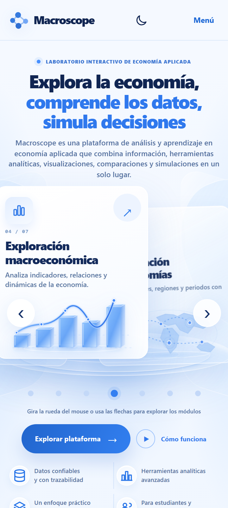
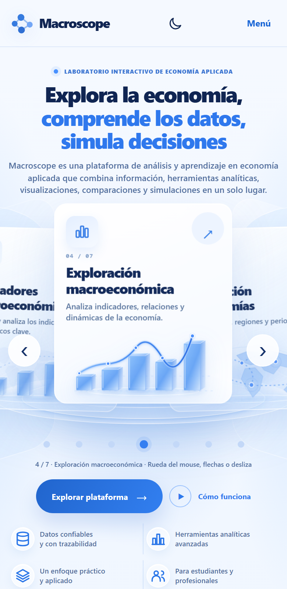
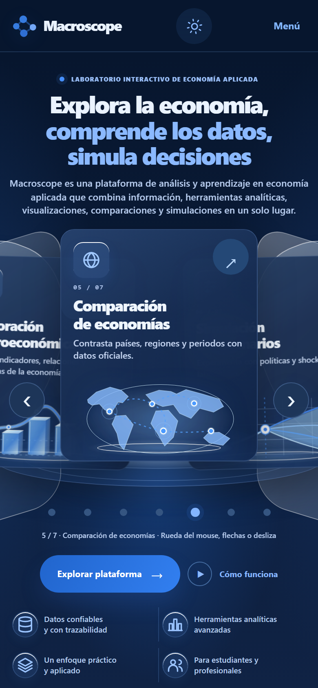

# Inicio táctil — Diagnóstico, arreglo y verificación del carrusel orbital

## 1. Problema reportado y reproducción antes del arreglo

**Petición del usuario:**
> «En celular no se desplaza con el táctil suave cuando le das a la derecha o izquierda, solo cuando le das en las flechas, pero eso se siente feo, debería ser con desplazamiento del táctil.»

**Reproducción observada antes del cambio (Chromium móvil `hasTouch: true, isMobile: true` con `CDP Input.dispatchTouchEvent` en `360px`, `390px` y `412px`):**
- Al iniciar un gesto táctil horizontal sobre el título/texto (`h2`/`p`), la ilustración SVG (`.orbit-illustration`) o el botón de enlace de la tarjeta (`.orbit-card-open`), durante los pasos `touchMove` el estado observado fue `isDragging: false` y `--orbit-drag: "0px"`, y al soltar (`touchEnd`) la tarjeta activa permaneció sin cambios (`Exploración macroeconómica`).
- El test previo en `tests/e2e.mjs` no detectaba el fallo porque despachaba `new PointerEvent(...)` sintético directamente sobre `.orbit-stage` desde JavaScript, omitiendo la captura implícita de puntero táctil del navegador sobre el elemento hijo tocado.

## 2. Causas reproducidas con evidencia

1. **Aborto inmediato por `lostpointercapture` burbujeante desde el elemento hijo tocado (causa raíz en cuerpo, título/texto e ilustración de la tarjeta):**
   - Según la especificación W3C Pointer Events, en entradas táctiles directas (`pointerType === 'touch'`), el navegador asigna automáticamente **captura implícita de puntero** (*implicit pointer capture*) al nodo descendiente que recibe `pointerdown` (`<h2>`, `
`, `
`, `<article class="orbit-card">`, etc.).
   - En el primer `pointermove` que superaba el umbral horizontal, `js/ui/landing.js` invocaba `stage.setPointerCapture(event.pointerId)`.
   - Al transferirse la captura desde el nodo hijo hacia `.orbit-stage`, el navegador emite `lostpointercapture` sobre el nodo hijo con `bubbles: true` inmediatamente antes de `gotpointercapture` en `.orbit-stage`.
   - El listener `stage.addEventListener('lostpointercapture', ...)` en `js/ui/landing.js` no verificaba `event.target === stage`, por lo que interpretaba la liberación del hijo como pérdida de captura del carrusel y ejecutaba `pointerStart = null; clearDrag();` en el primer frame (~10px), anulando todo el resto del gesto táctil.
2. **Bloqueo de gestos iniciados sobre el enlace de la tarjeta (`.orbit-card-open`):**
   - `pointerdown` descartaba cualquier evento con `event.target.closest('a,button')`. En móvil (`242px` de ancho de tarjeta), el enlace `.orbit-card-open` (`44×44px` en la esquina superior derecha) impedía iniciar el arrastre cuando el pulgar partía sobre esa zona, y además el reseteo de `suppressSwipeClick` ocurría después del filtro de `<button>`.

## 3. Cambios implementados (`js/ui/landing.js` y `css/landing.css`)

- **`js/ui/landing.js` (arreglo de las causas reproducidas y robustez del gesto):**
  - En `lostpointercapture`, se ignora el evento cuando `event.target !== stage` (transferencia normal desde el hijo con captura implícita táctil hacia `.orbit-stage`), conservando la limpieza si `.orbit-stage` mismo pierde la captura en mitad del gesto.
  - En `pointerdown`, se permite iniciar el seguimiento sobre toda la tarjeta (incluido `.orbit-card-open`), excluyendo únicamente `<button>` (`.orbit-arrow`), limpiando `suppressSwipeClick = false` al inicio de cualquier nuevo toque y bloqueando `dragstart` nativo de enlaces.
  - Arbitraje de eje e intención: si el gesto inicia claramente en vertical (`absY >= 10 && absY > absX * 1.05`), se bloquea el eje en `'y'` para respetar el desplazamiento vertical natural (`scrollY`) sin activar el carrusel; si inicia en horizontal (`absX >= 8 && absX > absY * 1.12`), se bloquea el eje en `'x'`, se activa `.is-dragging` y se aplica `renderDrag(dragX)` de forma continua y proporcional en las tarjetas antes de `touchend`.
  - Protección de puntero único (`event.isPrimary === false` o `pointerId !== pointerStart.id` ignorados sin saltos), umbral adaptativo al ancho del escenario / velocidad de flick mantendo el retorno suave en drags cortos (`~18–20px`) sin navegación accidental, y limpieza automática (`cancelActiveGesture`) en `resize`, `orientationchange`, `blur`, `visibilitychange` y `hashchange`.
- **`css/landing.css` (refuerzo defensivo):**
  - Aunque el arbitraje efectivo de `touch-action` en el navegador considera los ancestros (`.orbit-stage` y `.orbit-track` ya declaraban `touch-action: pan-y`), se añadió `touch-action: pan-y; user-select: none; -webkit-user-select: none; -webkit-user-drag: none` explícitamente en `.orbit-card, .orbit-card *` como refuerzo defensivo sobre las capas 3D internas, junto con `touch-action: manipulation` en `.orbit-arrow, .orbit-dot` y `pointer-events: none` en `.orbit-platform`.

## 4. Resultado de pruebas y evidencia móvil publicable

Suite independiente ejecutada con `node tests/landing-touch.mjs` (Playwright Chromium en contextos móviles con `hasTouch: true, isMobile: true` y eventos táctiles reales vía CDP `Input.dispatchTouchEvent` e `Input.synthesizeScrollGesture`):

- **360px, 390px y 412px:** swipe izquierda y derecha iniciado sobre título/texto (`h2`/`p`), ilustración SVG (`.orbit-illustration`) y enlace de la tarjeta (`.orbit-card-open`), comprobando movimiento en vivo antes de `touchend` (`is-dragging`, `--orbit-drag`, desplazamiento de `getBoundingClientRect().x` y paralaje en tarjeta vecina) y settle limpio sin navegación ni overflow horizontal.
- **Recorrido de 7 destinos canónicos y wrap circular:** avance `04/07 → 05/07 → 06/07 → 07/07 → 01/07` y retroceso `01/07 → 07/07` con sincronización de `.orbit-dot[aria-pressed="true"]`.
- **Drag corto y tap posterior:** drag corto (`-20px`) desplaza parcialmente y recupera posición al soltar sin abrir el enlace; un tap táctil posterior sobre el cuerpo de la tarjeta activa o sobre `.orbit-card-open` sí navega al módulo correspondiente (`#comparacion`).
- **Scroll vertical natural, `lostpointercapture`, cancelación y multitáctil:** gesto vertical sobre la tarjeta desplaza `window.scrollY > 0` sin activar `is-dragging` ni cambiar de tarjeta; `lostpointercapture` del descendiente conserva el drag activo mientras que `lostpointercapture` propio de `.orbit-stage` y `touchCancel` limpian el estado; un segundo dedo simultáneo no genera saltos.
- **Orientación/resize, `prefers-reduced-motion: reduce`, modo claro/oscuro, flechas, dots, teclado y mouse:** verificados sin regresiones (`7/7` en `tests/landing-touch.mjs` y `7/7` checks de Inicio en `tests/e2e.mjs`).

### Evidencia visual publicada (`docs/evidence/inicio-tactil/`)

- [Desplazamiento táctil en vivo antes de `touchend` (360px)](../evidence/inicio-tactil/landing-touch-360-dragging.png)
- [Estado asentado tras swipe táctil en modo claro (390px)](../evidence/inicio-tactil/landing-touch-390-settled.png)
- [Estado asentado tras swipe táctil en modo oscuro (390px)](../evidence/inicio-tactil/landing-touch-390-dark.png)

## 5. Límites de verificación en dispositivo físico

- **Chromium móvil (CDP `Input.dispatchTouchEvent` / `Input.synthesizeScrollGesture`):** VERIFICADO (`7/7` checks en `tests/landing-touch.mjs` + `7/7` checks de Inicio en `tests/e2e.mjs`).
- **iOS / Safari físico y Android físico:** **NO VERIFICADO** (ejecución realizada en entorno local Windows sin dispositivo iOS/Safari ni hardware móvil físico conectado).
